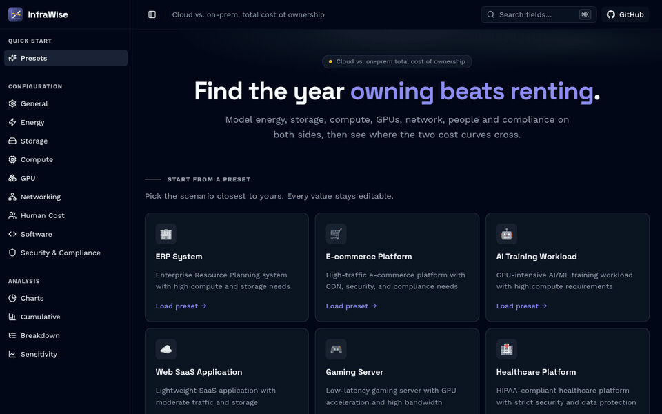
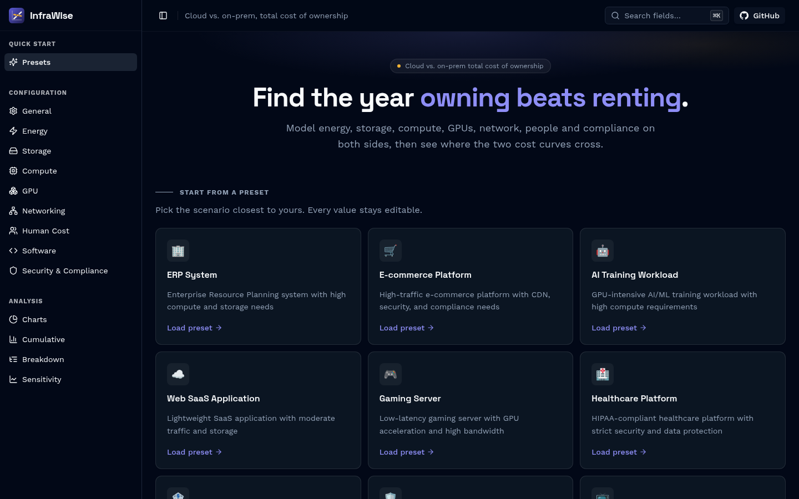
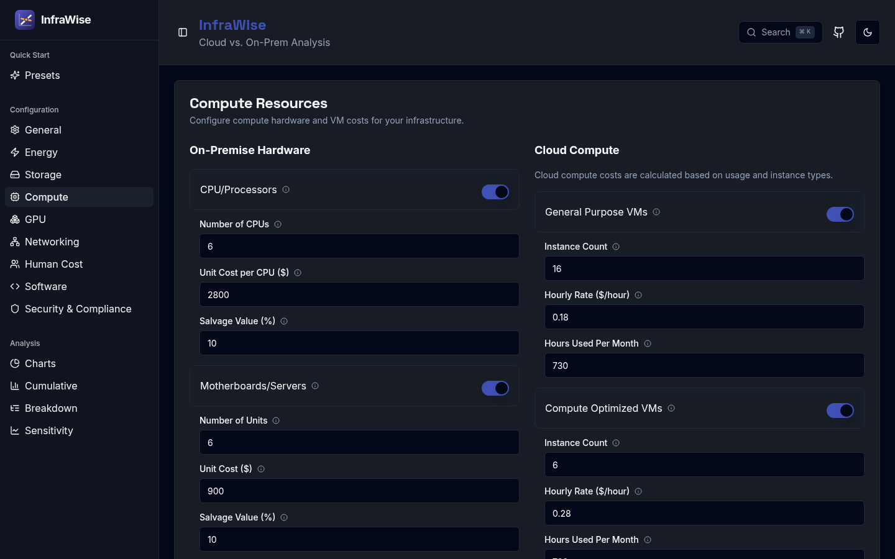
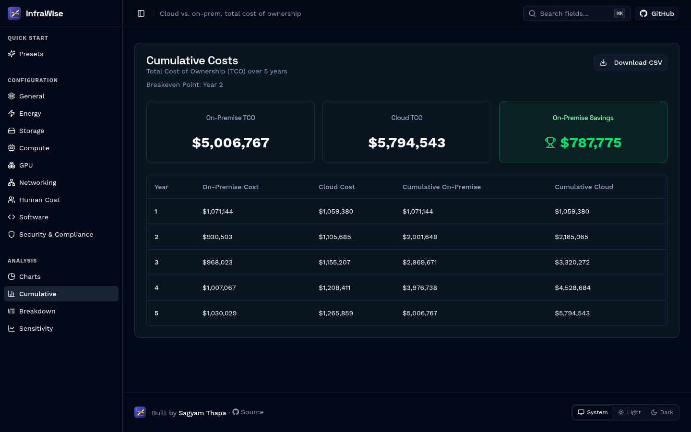
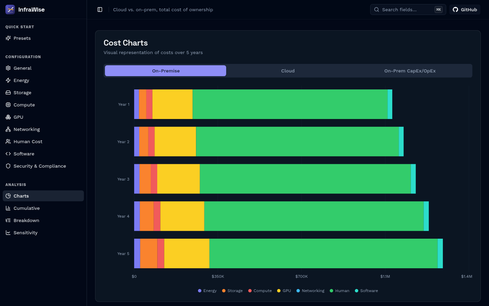
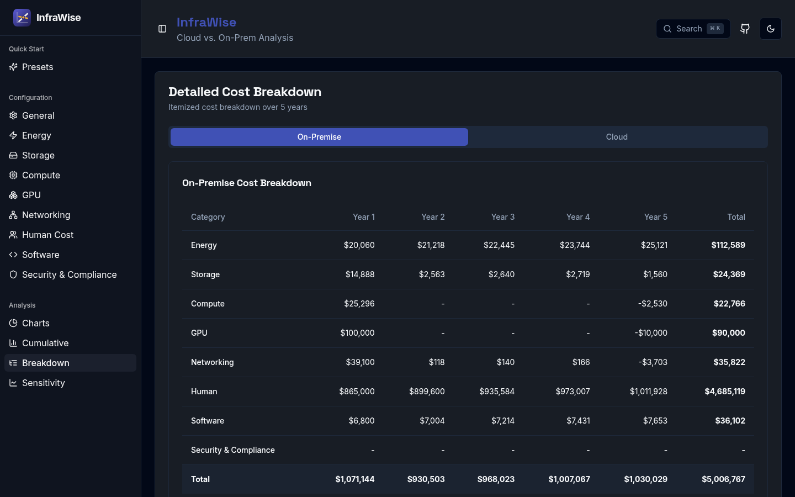
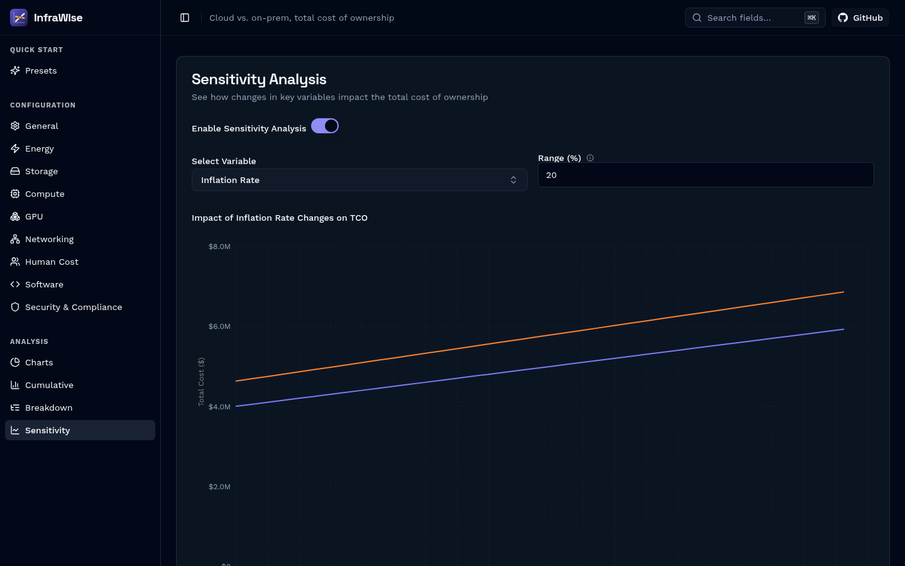

<p align="center">
  
</p>

<h1 align="center">InfraWise</h1>

<h3 align="center">Find the year owning beats renting.</h3>

<p align="center">
  <a href="https://infrawise.sagyamthapa.com.np">Live demo</a> ·
  <a href="#tour">Tour</a> ·
  <a href="#quick-start">Quick start</a> ·
  <a href="docs/USAGE.md">Guide</a> ·
  <a href="docs/FEATURES.md">Features</a>
</p>

<p align="center">
  <b>A total-cost-of-ownership calculator for cloud vs. on-premise infrastructure.</b><br>
  Model energy, storage, compute, GPUs, network, people and compliance, then see where the two curves cross.
</p>

<p align="center">
  
  
  
  
  
  
  <br>
  
  
  
  
</p>

<p align="center">
  
</p>

## Tour

<table>
<tr>
<td width="50%"><br><b>Presets.</b> Ten realistic starting points, from a SaaS app to an AI training cluster.</td>
<td width="50%"><br><b>Inputs.</b> Hardware on one side, cloud instances on the other. Every field explains itself.</td>
</tr>
<tr>
<td><br><b>Cumulative.</b> Total cost per side, the savings and the breakeven year, exportable as CSV.</td>
<td><br><b>Charts.</b> Where each year's money goes, by category.</td>
</tr>
<tr>
<td><br><b>Breakdown.</b> Every category, every year, on both sides.</td>
<td><br><b>Sensitivity.</b> Swing one variable and watch the totals move.</td>
</tr>
</table>

## Quick start

```bash
git clone https://github.com/Sagyam/Infra-Wise.git
cd Infra-Wise
bun install
bun dev         # http://localhost:3100
```

More in the [installation](docs/INSTALLATION.md) and [usage](docs/USAGE.md) guides.

## License

MIT. See [LICENSE](LICENSE).
